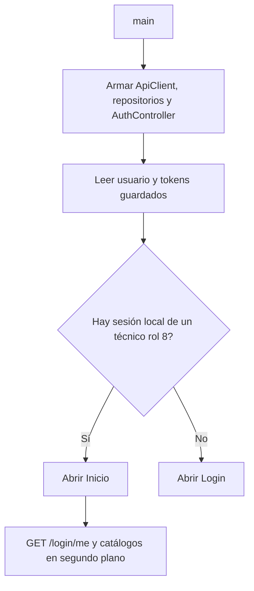
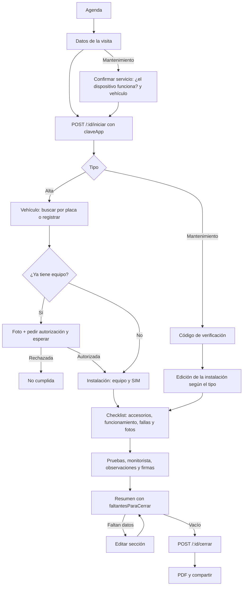

# Cómo opera Instaladores Spring

Aplicación Flutter para los técnicos instaladores de Spring Telecom (rol 8). El técnico atiende en campo las órdenes que operación le programa: instalación (alta), revisión, cambio de SIM, cambio de equipo y desinstalación. Se usa como PWA en `https://springtelecom.mx/ordenservicioapp/`.

Este documento explica cómo opera la app paso a paso. Para la visión general y las reglas de negocio ver [CONTEXTO.md](CONTEXTO.md); para los campos de cada servicio, [CONTRATO.md](CONTRATO.md).

La implementación sigue el contrato de NextAPI para la App de instaladores (`docs/app-instaladores.md` en el repositorio de NextAPI, rama `dev-isra`). Los números **§** de este documento son sus secciones. Si el contrato y el código del API no coinciden, manda el código del API.

La URL base del API es `https://springtelecom.mx/nextAPI/api`. Se puede cambiar al compilar con `--dart-define=API_BASE_URL=https://...`.

La orden vive en el servidor: cada paso se guarda con `PATCH` y las fotos se suben al momento. Si se cierra la app a mitad del flujo, al volver a abrir la orden desde la Agenda («En curso») se retoma con lo que ya está en el servidor.

---

## Arquitectura

Tres capas. Las pantallas no llaman al HTTP directamente.

```
Pantalla (solo muestra y captura)
  → ServiceOrderFlowController (único que habla con el API durante una orden)
    → ServiceOrderRepository (contrato en domain)
      → ServiceOrderRepositoryImpl + ServiceOrderModel (data)
        → ApiClient
```

| Capa | Qué contiene |
|---|---|
| `presentation` | Pantallas, `AuthController`, `ServiceOrderFlowController`, pasos del flujo |
| `domain` | Entidades (`ServiceOrderRecord`, `ServiceType`, estatus), contratos de repositorio, casos de uso de autenticación |
| `data` | Modelos JSON, datasources, repositorios y `OrderKeyStorage` (claveApp por orden) |
| `core` | Rutas, cliente HTTP, tema, ubicación, errores |

Los errores llegan a la interfaz como `Failure` con un mensaje en español. `FailureStatus` agrega `isNotFound` (404) e `isConflict` (409).

---

## Arranque



- El permiso de ubicación ya no se pide al arrancar: se pide al iniciar una orden, que es cuando se registra la ubicación.
- En web, `web/pwa.js` registra el service worker, quita la pantalla de carga y revisa si hay una versión nueva (ver «Versión web» al final).
- Al entrar a Inicio se cargan y guardan en memoria `GET /ordenes-servicio/catalogo` y `GET /ordenes-servicio/motivos` (§2).

### Sesión en cada petición

Toda llamada autenticada lleva `Authorization: Bearer`. Con un 401 se intenta `POST /login/refresh` una sola vez (aunque varias peticiones fallen a la vez) y se reintenta. Si el refresh se rechaza, se borra la sesión y se vuelve a Login. Un fallo de red o un 5xx no cierra la sesión.

---

## Autenticación (§1)

- `POST /login` → `GET /login/me`. **Si el usuario no es rol 8 no entra**: se cierra su sesión en el servidor, se borra lo local y se muestra «Esta aplicación es solo para técnicos instaladores». La misma regla aplica a la sesión guardada y a cada `GET /login/me` posterior.
- Credenciales malas → 401; límite de intentos → 429. Los dos con mensaje en español.
- Al cerrar sesión o expirar se limpian también los catálogos en memoria y las `claveApp` guardadas.
- Recuperar y cambiar contraseña siguen igual (`POST /login/usuario/recuperar/acceso`, `PATCH /usuarios/actualizar/contrasena`).

---

## Navegación

| Pestaña | Pantalla | Qué hace |
|---|---|---|
| Inicio | Bienvenida | Saludo, «Ver mi agenda» y «Ver mi historial» |
| Agenda | Agenda | Selector **Agenda \| Mes**; debajo, las órdenes **en curso** (`borrador`) y después el calendario con las **programadas** (`programada`, por cita) |
| Servicios | Historial | Órdenes **cerradas** y **no cumplidas**, con búsqueda y filtro por fecha |
| Perfil | Perfil | Datos de `GET /login/me` |

El menú lateral repite las cuatro pestañas (cambia de pestaña sin abrir otra pantalla) y agrega **Cambio de contraseña** y **Cerrar sesión**.

**Agenda:**

- Vista **Agenda:** un renglón por día con sus órdenes ordenadas por hora, agrupadas por mes.
- Vista **Mes:** cuadrícula donde cada día muestra sus órdenes como etiquetas de color con la hora (y «+n» si hay más). Al elegir un día se listan sus órdenes debajo. **Hoy** regresa al mes actual.
- Cada orden lleva el color de su tipo (ver CONTEXTO §6). Se cargan hasta 10 páginas de 50 programadas.

| Ruta | Pantalla |
|---|---|
| `/login` | Inicio de sesión |
| `/forgot-password` | Recuperar contraseña |
| `/home` | Pestañas (Inicio, Agenda, Servicios, Perfil) |
| `/change-password` | Cambio de contraseña |
| `/service-order?id=42` | Una orden de la agenda, de principio a fin |
| `/order-detail?id=42` | Detalle de una orden, PDF y compartir |

`AppRoutes` revisa la sesión al abrir cada ruta: sin sesión todo va a `/login`; con sesión, `/login` y las rutas desconocidas van a `/home`. El id en la URL permite recargar en web y volver a la misma orden.

---

## Orden de servicio



| Tipo | Clave | Pasos | Quién contesta las pruebas |
|---|---|---|---|
| Alta | `instalacion` | Vehículo → Instalación → Checklist → Pruebas → Resumen | Operador |
| Revisión | `revision` | Código → Instalación → Checklist → Pruebas → Resumen | Operador |
| Cambio de SIM | `c_sim` | Igual que revisión | Operador |
| Cambio de equipo | `c_equipo` | Igual que revisión | Operador |
| Desinstalación | `desinstalacion` | Igual que revisión | Técnico (en el `PATCH`) |

El indicador de pasos no deja saltar un paso que bloquea: el vehículo del alta (fijado y, si tenía equipo, autorizado) y el código de un mantenimiento.

### 1. Iniciar en campo (§4)

La pantalla muestra servicio programado, cliente, cita, vehículo, quién programó, observaciones de operación, «Unidad x de y» y referencia CRM.

- **Alta:** no se cambia el tipo (alta ↔ mantenimiento lo programa operación).
- **Mantenimiento:** se confirma el servicio entre los cuatro mantenimientos. Para revisión y cambio de equipo se pregunta «¿El dispositivo funciona?» (sí → revisión, no → cambio de equipo). `tipoServicio` solo se envía si difiere del programado.
- «Atender otro vehículo» busca por placa la instalación vigente y la manda como `idInstalacion`; el API valida que sea vigente y del cliente.
- `POST /:id/iniciar { claveApp, tipoServicio?, idInstalacion? }`. La `claveApp` es un UUID v4 generado **una sola vez por orden** y guardado en el teléfono (`OrderKeyStorage`); un reintento usa la misma.
- Después se registran `fechaCaptura`, `lat` y `lng` con `PATCH`. Si se niega la ubicación, `lat` y `lng` van en `null`.

### 2. Vehículo del alta (§6, §7)

1. `GET /productos/vehiculos/placa/:placa`. Si existe y es del cliente, se usa **sin modificar sus datos**. Si hay más de uno con esa placa el API responde 400 y se muestra el mensaje.
2. Si no existe: `POST /productos/vehiculos` con `idCliente` de la orden, `placa` y **las 6 fotos obligatorias** (principal, frontal, trasera, laterales y tarjeta de circulación); número económico, marca, modelo, año, color, VIN y combustible son opcionales. Mientras se registra, el botón muestra «Registrando vehículo…» y el formulario queda bloqueado para evitar un doble registro.
3. `PATCH { idProducto }`.
4. Si `faltantesParaCerrar` dice que el vehículo ya tiene equipo: foto `equipo_existente` y observaciones (las dos se piden en la App), `POST /:id/autorizacion`, y se consulta `GET /:id` cada 12 s hasta que `autorizacion` sea:
   - `autorizada`: se continúa con el alta (si el equipo estaba registrado en Next, al cerrar se da de baja la instalación anterior);
   - `rechazada`: la orden queda `no_cumplida` y se muestra.
5. Una vez pedida la autorización el vehículo ya no se puede cambiar.

### 3. Código de verificación (§8)

Solo mantenimientos de la agenda. `POST /:id/codigo` (el código no llega a la App: lo dicta el operador) y `POST /:id/codigo/validar { codigo }`.

- Incorrecto → se muestra el mensaje con los intentos que quedan.
- 409 al validar («se emitió otro código») → se limpia el campo para capturar el nuevo.
- 409 al pedir el sexto código → «Comunícate con operación para que reinicie los códigos» y ya no se ofrece pedir otro.

### 4. Instalación (§5)

El equipo y la SIM que entran salen de `GET /dispositivos/list?idCliente=` y `GET /sims/list?idCliente=` (almacén y reservado al cliente). Lo que no se puede instalar se marca «No disponible».

| Tipo | Se envía |
|---|---|
| Alta | `idDispositivoNuevo` y `idSimNuevo` (opcional) |
| Cambio de equipo | `idDispositivoNuevo` y `estatusSalienteAnterior` |
| Cambio de SIM | `idSimNuevo` y `estatusSalienteAnterior` |
| Desinstalación | `estatusInstalacionBaja`: 0 inactiva o 5 inservible |
| Revisión | Nada |

`estatusSalienteAnterior`: 3 por revisar, 4 laboratorio o 5 inservible (0 y 1 ya no se aceptan). En mantenimientos se muestra el equipo y la SIM actuales (`GET /instalaciones/:id`).

### 5. Checklist (§5)

Opciones sí/no de `vehiculo_cuenta_con`, `funcionamiento_vehiculo` y `fallas_equipo`; se envían **todas** porque el servidor las exige para cerrar. En el alta las fallas no se muestran y van en «no». Fotos del catálogo (`tablero_inicio`, `tablero_final` obligatorias; `falla_extra_1..3` opcionales, no en el alta). Las fotos ya subidas se ven desde el servidor y se pueden reemplazar.

Cada foto (también `equipo_existente`) se sube **en cuanto se toma** y muestra su estado: ⏳ enviando, ✓ enviada o ↻ falló (se toca para reintentar). «Siguiente» y «Solicitar autorización» esperan a que terminen y reintentan las que fallaron.

### 6. Pruebas y firmas (§9)

- Pruebas del catálogo; `paro_motor` solo si `vehiculo_cuenta_con.inmovilizador` = sí.
- Órdenes de la agenda: «Solicitar prueba» (`POST /:id/pruebas/:clave/solicitar`, nota opcional). Se consulta `GET /:id` cada 12 s mientras haya una prueba `solicitada`. Si falla se puede volver a solicitar. Una `anulada` se ve en gris.
- Desinstalación y borradores sin origen (§14): el técnico contesta las pruebas en el `PATCH`.
- Monitorista (obligatorio), observaciones (obligatorias si `fallas_equipo.otro` = sí), firmas del catálogo. Las firmas guardadas se muestran y se pueden repetir.

### 7. Resumen y cierre (§10)

El resumen se recarga del servidor y muestra `faltantesParaCerrar` tal cual. «Registrar orden» solo se habilita con la lista vacía. Cada sección tiene «Editar» (el vehículo solo antes de pedir la autorización). `POST /:id/cerrar`; si responde 400 con `faltantes` se muestra la lista. Cerrar es seguro de reintentar.

### No se pudo realizar (§11)

Desde el menú de la orden. Motivos de `/motivos` con `no_cumplida` en `resultado` y `tecnico` en `quien`; si el motivo lo pide, observaciones. Si la orden no estaba iniciada se inicia primero. El técnico no cancela órdenes: eso lo hace operación.

### Errores (§13)

| HTTP | Qué hace la App |
|---|---|
| 400 | Muestra el mensaje |
| 401 | Renueva el token y reintenta |
| 403 | Muestra el mensaje, no reintenta |
| 404 | La orden ya no es del técnico: avisa y regresa a la agenda, que se recarga |
| 409 | Recarga la orden y muestra el mensaje |
| 5xx / red | Muestra el mensaje; iniciar, guardar, archivos y cerrar son seguros de repetir |

---

## Historial, detalle y PDF (§3, §12)

- Historial: `GET /ordenes-servicio/paginado/:page/:limit?estatus=cerrada` o `no_cumplida`, con búsqueda y filtro de fecha en el teléfono.
- Detalle: `GET /ordenes-servicio/:id`. Las URL de fotos y firmas duran 5 minutos; al deslizar hacia abajo se renuevan.
- **Ver PDF** (cualquier estado): `GET /:id/pdf`. En el teléfono se guarda en temporales y se abre con el visor; en web se descarga como `<folio>.pdf`.
- **Compartir** (solo `cerrada` o `no_cumplida`):
  - WhatsApp: `POST /:id/compartir { telefono? }` y se abre el enlace `whatsapp` que devuelve (vigente 168 h). En web aparece «Enlace listo» con **Abrir WhatsApp**, porque el navegador bloquea las ventanas que no abre un toque.
  - Correo: `POST /:id/enviar-correo { correos: [...] }`, de 1 a 5.

---

## Qué guarda cada paso

| Momento | En el teléfono | En el servidor |
|---|---|---|
| Iniciar | `claveApp` de la orden | `iniciar` y `PATCH` con fecha y ubicación |
| Vehículo (alta) | Nada | Alta del vehículo si no existía, `PATCH idProducto`, autorización |
| Código | Nada | Código pedido y validado |
| Instalación | Nada | `PATCH` del equipo, SIM o estatus |
| Checklist | Fotos subidas en esta sesión (para no reenviarlas) | `PATCH respuestas` y archivos |
| Pruebas y firmas | Igual | Solicitudes de prueba, `PATCH` y firmas |
| Cerrar o no cumplida | Se borra la `claveApp` | Orden cerrada o no cumplida |

---

## Permisos y red

- Ubicación: al iniciar una orden y, si no se pudo, al guardar las pruebas. Máximo 15 s para obtener la posición y 30 s en total con el aviso de permiso; si no llega, se usa la última conocida (en el teléfono) o la orden sigue sin coordenadas.
- Cámara y galería: fotos del vehículo, del checklist, del equipo encontrado y firmas.
- Tiempo de espera: 30 segundos en JSON y 120 segundos al subir archivos.
- Las respuestas JSON se leen en la raíz o dentro de `data`, sin distinguir mayúsculas en las claves. Los errores en texto o en JSON se leen igual (`message`).

---

## Salir y volver a la app

- Mientras la app está oculta (otra app, otra pestaña o pantalla apagada) se pausa la consulta de cada 12 s.
- Al volver, la orden se recarga de inmediato si se esperaba la autorización o una prueba, o si pasó más de 1 minuto.
- Si se cierra la app, al volver a abrir la orden desde «En curso» se retoma en el estado guardado en el servidor.

## Versión web

| Tema | Cómo funciona |
|---|---|
| Dirección | `https://springtelecom.mx/ordenservicioapp/#/home`. Las rutas llevan `#`, así que nginx no necesita reescrituras |
| Sin conexión | `web/sw.js` pide primero la red y, sin conexión, usa la copia guardada: la app abre pero operar requiere red. Nunca guarda respuestas del API ni fotos de S3 |
| Versión nueva | Al volver a la app o cada 30 min se compara `build.json`; si cambió aparece «Hay una versión nueva de la app» con **Recargar**, en la parte superior |
| Instalar | Android: Chrome → **Instalar app**. iPhone: Safari → Compartir → **Agregar a inicio** |
| Atrás | El botón atrás del navegador regresa un paso de la orden; en la PWA de iPhone se usa la flecha de la app |
| Fotos | En web la conversión a JPG usa el canvas del navegador. La foto de perfil se muestra con `` si el navegador tiene una copia sin CORS |
| Publicar | Ver el anexo de [PLAN_PWA.md](PLAN_PWA.md) |
